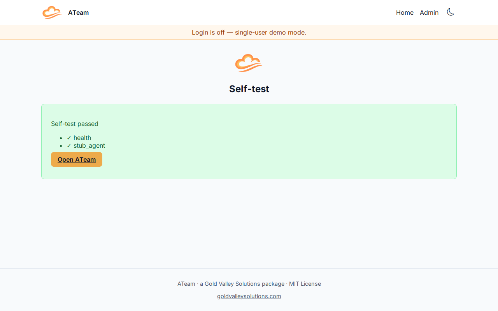
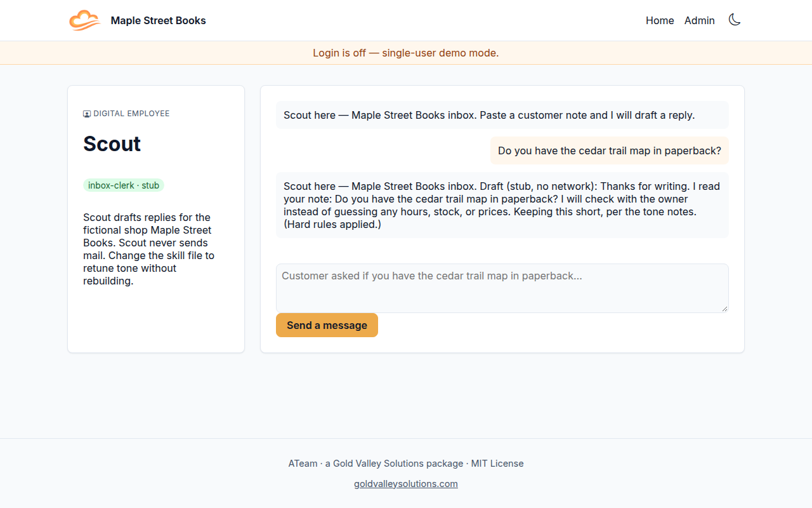

<p align="center">
  
</p>

# ATeam

Self-hosted digital employees that a small business owner runs on their own machine, with the model of their choice.

[](LICENSE)
[](VERSION)

## What it does

- Runs AI digital employees (agents) on a machine you control, not a shared cloud workspace.
- Lets you pick the model in a first-run wizard. Stub is the default and stays on this machine.
- Keeps mail, SMS and other connectors off until you turn them on.

## Screenshot





## Prerequisites

You need **Docker** and **Docker Compose**, and about **4 GB of RAM** for the default hosted profile (nginx, the app, Postgres). Optional profiles need more; see [Profiles and RAM](#profiles-and-ram).

Copy `.env.example` to `.env`. Empty values are enough for a local stub run. Every variable marked `# credential` in `.env.example`:

| Variable | Where to get it | Cost | Required to start? |
|---|---|---|---|
| `POSTGRES_PASSWORD` | You choose it. Leave empty in development and Compose uses a local-only default. | $0 | Only when `ENVIRONMENT=production` |
| `ANTHROPIC_API_KEY` | [Anthropic console](https://console.anthropic.com/settings/keys) | Usage-based; $0 unless you pick Anthropic in the wizard | No |
| `POSTMARK_API_TOKEN` | [Postmark](https://postmarkapp.com/) | Usage-based; stub by default | No |
| `TWILIO_ACCOUNT_SID` | [Twilio console](https://www.twilio.com/console) | Usage-based; stub by default | No |
| `TWILIO_AUTH_TOKEN` | Same Twilio console | Usage-based; stub by default | No |
| `TWILIO_FROM_NUMBER` | A Twilio number in E.164 form | Usage-based; stub by default | No |

No paid API is called unless you switch that provider or connector on.

## 5-minute setup

```bash
git clone https://github.com/mike-gvs/a-team.git
cd a-team
cp .env.example .env
make up
```

Open [http://127.0.0.1:8080](http://127.0.0.1:8080). The first visit is the setup wizard. Keep the defaults (stub model, login off, connectors stub) and finish. You should land on Scout, a fictional inbox clerk for Maple Street Books.

`make up` binds **localhost only** (`HOST_BIND=127.0.0.1`). LAN access: `HOST_BIND=0.0.0.0 make up`. A public tunnel is opt-in: `docker compose --profile tunnel up`.

Check health:

```bash
curl -f localhost:8080/health
docker compose ps
```

## Run it yourself, or have Gold Valley host and manage it

Run this package on your own machine with the steps above. If you would rather have Gold Valley host and manage it, [send a message](https://www.goldvalleysolutions.com).

## AI provider and data handling

The setup wizard is where you pick the AI provider. **Prompts and data go to whichever provider you pick.** Each provider handles that data under its own terms. The stub provider stays on your machine and makes no network calls. Anthropic is the first live provider; others plug in through the same provider interface. Continuous integration and the default install use the stub only.

## Data and privacy

Working with health records? When you run a project yourself, you choose an AI provider and host that fit your compliance needs. Our hosting and builds don't process patient health information.

## What's stubbed

| Piece | Default | Live option |
|---|---|---|
| Model | Stub echo of the skill file | Anthropic (wizard) |
| Email | Dev sink in the database | Postmark, if you switch the connector to live and paste `POSTMARK_API_TOKEN` |
| SMS | Off / stub | Twilio, if you switch it to live |

Scout never sends mail, even if email is live. That rule lives in code, not in the skill file.

## Configuration

Three layers, not mixed:

1. `.env` — secrets and deploy settings only.
2. `config/models/` — backend, model name, limits, monthly cap. Stub is the default ($0).
3. `config/connectors/` — each connector with `enabled`, `stub` / `live`, and which secret names it needs.

Skills live in `skills/` (Agent Skills `SKILL.md`). Tone notes live in `prompts/`. Edit those files to retune Scout without rebuilding; they are mounted into the app container.

## Architecture

Default stack: **nginx 1.25** (port 8080) → **FastAPI** (Python 3.11) → **Postgres 16**. Shared UI kit: `gvs-ui@0.1.0`. Optional Compose profiles add Temporal and Langfuse; they are off unless you pass `--profile`.

```
browser → nginx :8080 → app :8000 → postgres
                       → /gvs-ui and /static
```

## Profiles and RAM

| Profile | What it runs | RAM |
|---|---|---|
| Default / hosted (no extra profiles) | nginx, app, Postgres, stub model | 3–4 GB |
| `--profile workflows` | Temporal 1.24 + UI (localhost:8088) | extra ~2 GB |
| `--profile tracing` | Langfuse 2 (localhost:3000) | extra ~2 GB |
| `--profile tunnel` | cloudflared to nginx | small; publishes the UI off localhost |

Admin UIs for optional profiles bind localhost only.

## Backups

See [docs/backup.md](docs/backup.md). `make backup` / `make restore`. Scope is Postgres and config, not secrets. Default schedule: nightly, 7 dailies.

## Support

Named in [deploy/DEPLOY_RECORD.md](deploy/DEPLOY_RECORD.md) (fictional demo values ship in the package).

- P1 — down or a safety issue. Target: same day.
- P2 — degraded. Target: next business day.
- P3 — question. Target: two business days.

## License

MIT. Copyright 2026 Gold Valley Solutions. See [LICENSE](LICENSE).

---

<p align="center">
  <br>
  Gold Valley Solutions · ATeam
</p>
